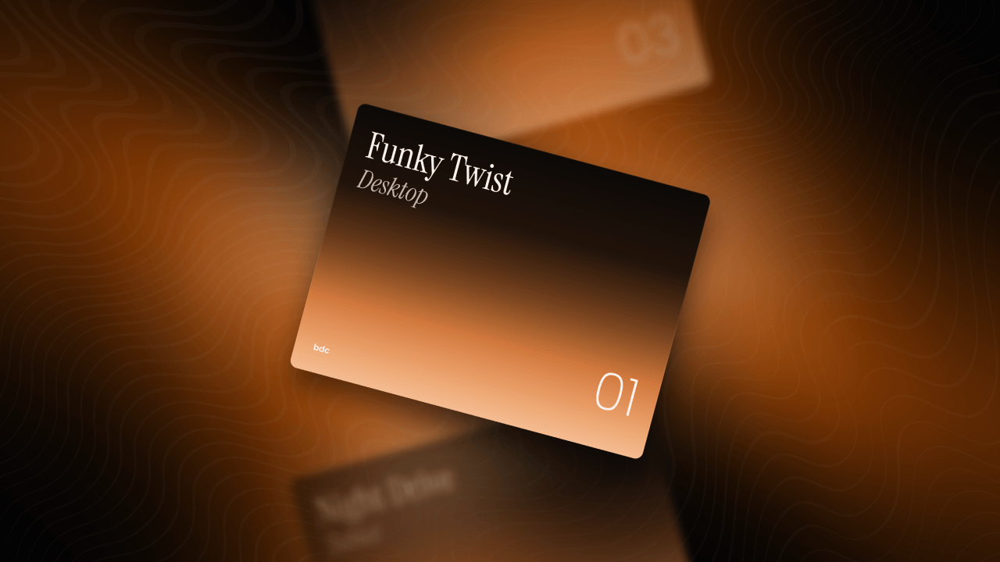

# Responsive Modern Carousel

This project is part of a YouTube tutorial in which we build a insane responsive modern carousel from scratch using HTML CSS & JavaScript

## 🎬 [Watch the Demo & Code](https://youtu.be/2S0kNUtiPXM) 

 

### 📌 Project Features 
- Responsive Modern Carousel Using HTML CSS JavaScript (Mobile First) 
- Clear and semantic HTML structure.
- Use of CSS variables.
- With interactive buttons.
- Neon effect on the card.
- Modern swipe animations.

### 📦 Download the resources directly 
1. Click the green **code** button.
2. Click **Download ZIP**.
3. Extract the ZIP file and open the project in your code editor.

You can **clone** the repository to your local machine or **fork** it in your GitHub account to obtain the source code.

```bash
# Clone the repository using HTTPS
git clone https://github.com/bedimcode/responsive-modern-carousel.git
```

Designed & developed with ❤️ by **[Bedimcode](https://www.youtube.com/@Bedimcode)**
